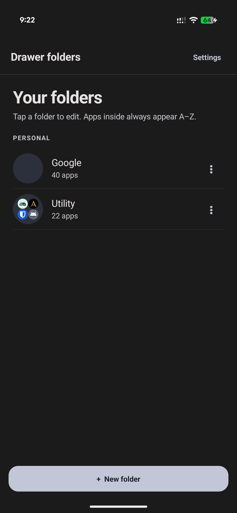
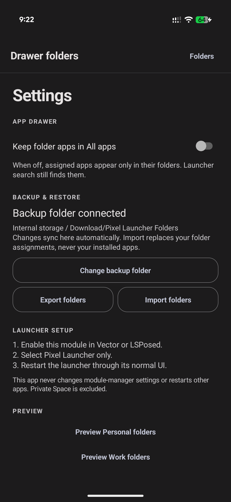
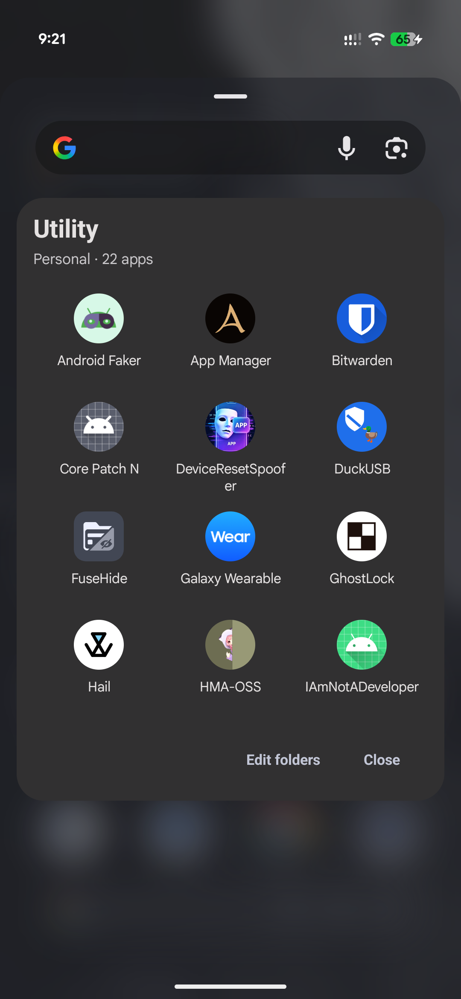
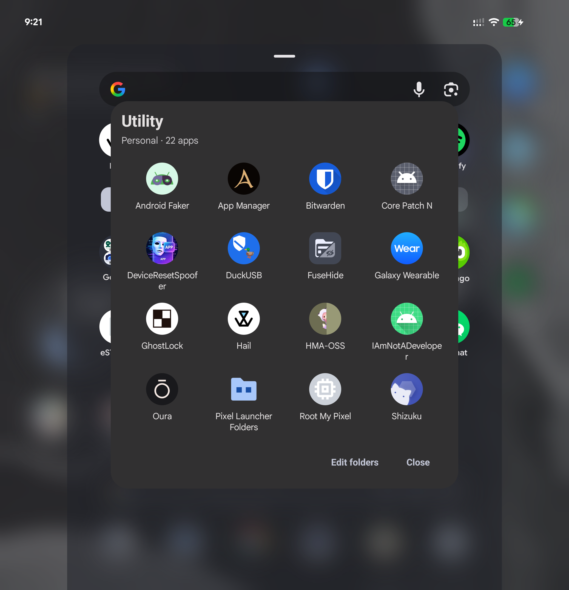

# Pixel Launcher Folders

Pixel Launcher Folders is an Xposed/LSPosed module that adds customizable
folders to the Pixel Launcher app drawer.

## Features

- Create and arrange folders as normal app-drawer cells.
- Sort folder contents and four-icon previews alphabetically.
- Optionally keep folder apps out of the main alphabetical app list.
- Launch apps with a tap and start the launcher drag flow with a long press.
- Back up and restore folder assignments through Android's user-selected Files
  storage without installing, removing, or modifying apps.
- Preserve Android profile identity and exclude Private Space.

## Requirements

- Android 15 or newer.
- Root access with LSPosed, Vector, or a compatible Xposed framework.
- Pixel Launcher package `com.google.android.apps.nexuslauncher`.

Enable the module only for Pixel Launcher. The tested target is Pixel 11 Pro
Fold, Android 17, Pixel Launcher 17. Other launcher versions are unverified.
This is a beta release. Split-screen and pop-up dragging remain experimental;
disable the module's launcher scope if an update causes problems.

## Installation

1. Install the APK from [Releases](https://github.com/Xposed-Modules-Repo/com.lixingchi.pixellauncherfolder/releases).
2. Enable Pixel Launcher Folders in LSPosed or Vector.
3. Scope it only to `com.google.android.apps.nexuslauncher`.
4. Restart Pixel Launcher and open the Pixel Launcher Folders settings app.

## Safety and privacy

The module does not edit the launcher database, modify APKs, install apps, or
read Private Space. Backups are written only to the Files location selected by
the user. No Internet permission is required.

## Screenshots

<table>
<tr>
<td width="50%"></td>
<td width="50%"></td>
</tr>
<tr>
<td width="50%"></td>
<td width="50%"></td>
</tr>
</table>

## Support

Report issues at the [source repository](https://github.com/doccstat/pixel-launcher-folder/issues)
with the device model, Android version, Pixel Launcher version, module version,
and reproduction steps. This project is not affiliated with Google, Pixel
Launcher, or LSPosed.
